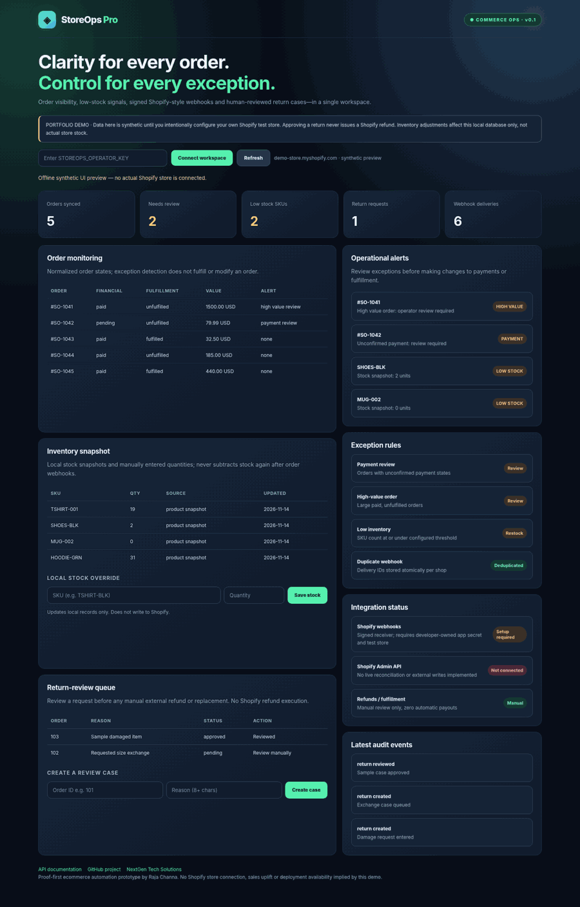
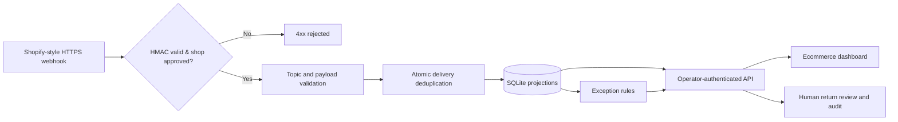

<div align="center">

# StoreOps Pro
### E-commerce operations automation: signed webhooks, order exceptions and inventory intelligence

**FastAPI · Python · SQLite · Shopify-compatible inbound webhooks · Responsive dashboard**

[](#quick-start) [](#architecture) [](https://github.com/rajachanna/StoreOps-Pro/actions/workflows/ci.yml) [](LICENSE) [](#what-it-does)

[Dashboard preview](docs/assets/storeops-dashboard.png) · [Engineering case study](docs/CASE_STUDY.md) · [Security boundaries](SECURITY.md) · [Client requirements](docs/CLIENT_BRIEF.md) · [Contact NextGen Tech Solutions](https://nextgentechdev.com)

</div>



> **Scope:** Working local prototype with verified HMAC logic using synthetic Shopify-style deliveries. No real Shopify store has been connected or tested. No external inventory updates, refunds, fulfillment actions, payment processing, or commercial outcomes are claimed.

## Why this project?

Shopify and other e-commerce stores often need a practical control plane for **unpaid orders, large orders needing review, low-stock products, repeated callbacks, and return approvals**. Most of the hard work is at the boundaries: authentication, preserving source-of-truth state, safe deduplication, explicit human review and clear limitations.

StoreOps Pro demonstrates these engineering fundamentals without pretending to be a production Shopify app.

## What it does

| Module | Implemented behavior | Not claimed |
| --- | --- | --- |
| Order sync projection | Signed `orders/create` and `orders/updated` deliveries, local normalized fields | Periodic reconciliation or Shopify Admin API reads |
| Webhook security | Raw-body Shopify HMAC-SHA256, shared secret, configured `myshopify.com` store check | Production provider verification or merchant OAuth |
| Delivery deduplication | One delivery ID processed once, even with retried calls | Complete event processing / reconciliation guarantees |
| Out-of-order protection | Older `updated_at` cannot overwrite newer local projection | Perfect sync across missing/out-of-order API events |
| Order exceptions | Flags pending/unknown payment and high-value unfulfilled orders | Automated risk decisions or fraud verdicts |
| Stock alerts | Product snapshot inventory *only when quantity is explicitly present*, or operator overrides | Live stock authority or automatic decrements on order creation |
| Return review | Pending → approved/rejected with immutable review state and audit | Refunds, shipping labels or inventory adjustments on Shopify |
| Dashboard | Live local API summary, order views, alerts, returns and stock controls | Hosted multitenant SaaS or private production portal |
| CI tests | 47 local automated unit/integration checks and one-command demo | Real-time production workloads |

### Architecture



## Quick start

Requirements: **Python 3.11 or higher**. No actual Shopify account is needed for the local scenario.

```bash
git clone https://github.com/rajachanna/StoreOps-Pro.git
cd StoreOps-Pro
python -m venv .venv
# macOS/Linux: source .venv/bin/activate
# Windows PowerShell: .venv\Scripts\Activate.ps1
pip install -e ".[dev]"
python -m pytest -q
python scripts/demo.py
```

Start the dashboard locally with an **independent operator key**. This environment value is required for the private API; leaving it unset fails closed. **Do not use the sample secret values in any internet-facing deployment.**

```bash
# macOS / Linux example. Replace with your own cryptographically secure random key.
export STOREOPS_OPERATOR_KEY="your-unique-operator-key-at-least-24-characters"
uvicorn storeops.api:app --host 127.0.0.1 --port 8000
```

On Windows PowerShell, set `$env:STOREOPS_OPERATOR_KEY = "your-unique-..."`, then run the same Uvicorn command. In Docker, copy `.env.example` to `.env`, update the key, then run `docker compose up --build`. Do not check `.env` into Git.

Open [http://127.0.0.1:8000](http://127.0.0.1:8000) for the dashboard and [http://127.0.0.1:8000/docs](http://127.0.0.1:8000/docs) for API explorer. The empty dashboard is expected before the first synthetic import; `python scripts/demo.py` uses its own **temporary database** and does not seed your active database.

### API operator example

```bash
curl -H "X-Operator-Key: YOUR_PRIVATE_OPERATOR_KEY" \
  http://127.0.0.1:8000/api/overview
```

Other operator routes include `GET /api/orders`, `GET /api/alerts`, `GET /api/stock`, `POST /api/stock`, `GET /api/returns`, `POST /api/returns`, `POST /api/returns/{id}/review`, and `GET /api/audit`.

### Shopify webhook integration — *optional, unverified with a real account*

A developer-owned app and test store are required. Configure both as environment variables:

```bash
STOREOPS_SHOPIFY_SECRET=YOUR_APP_CLIENT_SECRET
STOREOPS_SHOP_DOMAIN=your-test-store.myshopify.com
```

Webhook URL (requires your own properly protected public **HTTPS** deployment): `POST https://your-domain.example/webhooks/shopify`

Topics recognized in this prototype: `orders/create`, `orders/updated`, `products/update`.

The receiver validates **the exact raw request bytes** with `X-Shopify-Hmac-Sha256`, uses `X-Shopify-Shop-Domain` as an allowlist check, and deduplicates by `X-Shopify-Webhook-Id`. The demo includes intentionally invalid and repeated callbacks in tests.

**Shopify limitations:** Current Shopify product payloads are not guaranteed to include the stock quantity. This adapter doesn't invent such data, and it doesn't decrement stock on order callbacks. Webhook delivery can be delayed/out of order or lost; a production integration requires initial full sync, reconciliation jobs, API version checks, app subscriptions, Shopify installation OAuth, store-level permissions and handling of secret rotations.

Relevant current official Shopify docs: [Verify deliveries](https://shopify.dev/docs/apps/build/webhooks/verify-deliveries) · [Webhook headers](https://shopify.dev/docs/api/webhooks/latest) · [Delivery ordering and reconciliation](https://shopify.dev/docs/apps/build/webhooks).

## See the proof

- `tests/test_api.py` includes valid/tampered HMAC requests, unexpected shop, missing secret, idempotency, timestamp precedence, stock handling, exception reviews, refund safety and auth tests.
- `tests/test_logic.py` covers currency parsing, time zones, invalid amounts and scenario classifications.
- `scripts/demo.py` exercises **3 orders, duplicate delivery, product inventory snapshots, 2 exception alerts, 2 stock alerts and manual return review**. All identifiers and store details are fictional.
- `.github/workflows/ci.yml` reruns tests, the demo and builds a Python wheel on pushes/pull requests. See the actual Actions results rather than relying on a static badge.
- The screenshot is a browser-rendered preview of the actual dashboard HTML, with synthetic example records injected for the visual. It is **not** a live Shopify connection or evidence of a deployed production dashboard.

## Security & responsible usage

The service is **not** production ready. Before a live merchant deployment it needs tenant isolation, rate limiting, HTTPS, durable queue, full Shopify reconciliation, provider-verified contract testing, staff-level RBAC, credential rotation, privacy/compliance review, explicit retention policies, backups and monitoring. Never expose `X-Operator-Key` on an open public webpage. See [SECURITY.md](SECURITY.md).

## For potential clients

**Possible custom projects:** Shopify order exception automation, low-stock monitoring, human-assisted returns, webhook verification, fulfillment integrations, 3PL/WMS routing, operations dashboards, and safe n8n/Make workflows. This repo is a starting **engineering demonstration**, not a complete production solution.

**Raja Channa** · **NextGen Tech Solutions** · [Website](https://nextgentechdev.com) · [GitHub](https://github.com/rajachanna) · [Requirements checklist](docs/CLIENT_BRIEF.md).

MIT license. Contributions and bug reports are welcome.
